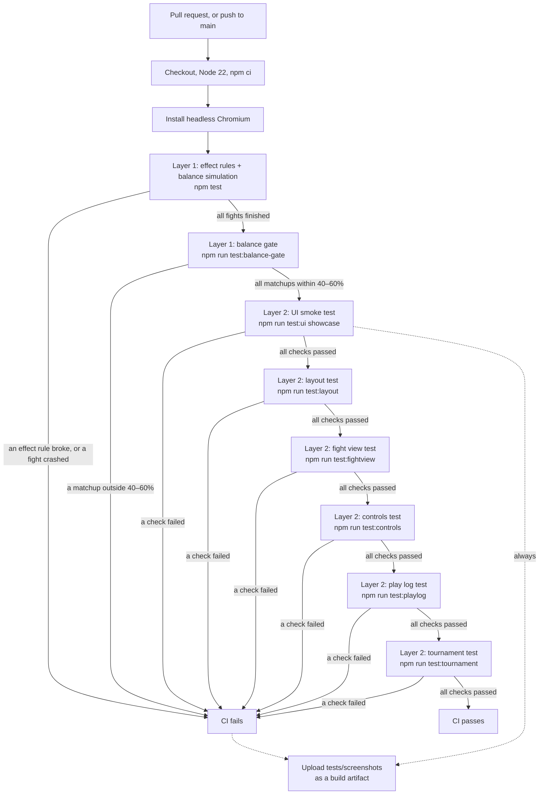

# Testing

Drake Arena is a single HTML file with no build step, so the tests work on that file as it is. The testing has two layers:

1. **Effect rules, ultimates, game rules and balance simulation** (`tests/effects.js`, `tests/ultimates.js`, `tests/rules.js`, `tests/balance.js` + `tests/sim_harness.js`) run the real game code in Node. The effect, ultimate and rules tests check the buff/debuff, meter, ultimate, chat and fight rules; the balance sim plays thousands of fights. Together they answer: *do the rules work as written, is the game fair, and does combat ever crash?*
2. **UI smoke test, layout test, fight view test and tournament test** (`tests/ui.js`, `tests/layout.js`, `tests/fightview.js`, `tests/tournament.js`) open the page in headless Chromium, play it through fake chat and check the layout, the battle log and the turn animation. They answer: *does it work and look right on stream?* The play log test (`tests/playlog.js`) checks what the game records about play and its export.

Both run in CI (`.github/workflows/ci.yml`) on every pull request and on every push to `main`, so each PR update runs CI once.

## Pipeline



## Layer 1: effect rules

`effects.js` (`npm run test:effects`, also the first step of `npm test`) loads the game script the same way the balance sim does (`tests/game_env.js`: stub page, instant timers, seeded `Math.random`) and checks the 12 buffs/debuffs in the `EFFECTS` table. It takes about a second.

| Check | What it catches |
|---|---|
| 12 effects; each viewer element has one buff and one debuff; each has an icon, Ukrainian and English names, a description with every `{number}` filled in, a duration unit and a count | A half-added effect, a typo in the table, a description that shows `{dmg}` or `NaN` |
| Stoneskin and Armor Break are gone from the game file | The removed effects creeping back |
| Chip text in both languages, including Ukrainian plurals (1 атака / 2 атаки / 5 атак / 21 атака) | "ще 5 атаки"-style grammar slips |
| Effect power (Purple + an effect-strength title) scales the percentages but not the count | Purple making effects last longer |
| Refresh: casting an active effect resets its count and is logged. Replacement: a third buff/debuff replaces the one closest to ending (the older one on a tie), and the log names both. Dispel removes every buff and takes no slot | Stacking duplicates, replacing the wrong effect, silent replacements |
| Debuff immunity (title and White Dragon) ignores all 6 debuffs, Dispel included, and keeps its own buffs | Immunity lost in the rework, or a debuff that skips the check |
| Casting split: Red picks its own pair ~75% of the time (70% + 30% × 2/12), half of those the buff; the White Dragon picks evenly from all 12 | A wrong split or a broken random pick |
| **Real fights** (300 per language, all elements, ability titles, the White Dragon): before every `[Turn N]` log line, every active effect's count is compared with the state after the previous turn or cast. Own-attack effects must drop by 1 when their owner attacks, hits-taken effects when their owner is attacked (blocked or not), turn effects when their owner's turn starts. On a frozen turn only the owner's turn effects and Frost itself go down. An effect may only disappear when its count reaches 0 | A count going down on the wrong event, by 2, or not at all; Frost eating other buffs; effects vanishing early |
| No internal effect id (`rage`, `mark`, ..., or the old `stoneskin`) appears in any battle-log line, in either language, and all 12 effect names show up | Log text built from the id instead of the table |
| An immune fighter never carries a debuff during a real fight | Immunity bypassed by a title mechanic (chaos, cat) |
| No effect name (uk or en, whole word) or icon appears anywhere in `showcase/index.html` outside the `EFFECTS` block, comments excepted. Lines that use an icon or word for something unrelated (🛡️ on Ultra Block and the defence label, title icons like 🎯 Missed the Button, the Guardian title's "Щит надії / Shield of Hope", ...) are listed in `EFFECT_TEXT_ALLOWLIST` in `effects.js`, each with its reason. An allowlist entry that no longer matches a line also fails | An effect name or icon typed into the code instead of read from `EFFECTS`, which would go out of date on the next rename |
| **Cast chance** with fixed dice, for a plain drake (30%), a Purple level-20 drake (30 + 20 + 15 = 65%) and a plain drake with a +15% effect-chance title (45%). The line comes from the rule, not from the game. A damaging hit casts on a roll 0.5 under the line, not on the line or 0.5 over it; an ultra-blocked hit (0 damage) never casts, even on a roll of 0 | A wrong cast chance, a missing element or title bonus, an off-by-one at the line, casts on hits that did no damage |
| **What each effect does** (one test per effect, below) | An effect that has the right name and count but the wrong effect on the fight |

**What each effect does.** These tests script single turns of the real fight loop. Two plain level-20 drakes (no element, no title, 340 HP) fight with fixed dice, so a turn's damage is exact. Each test casts the effect with the game's own `applyEffect`, runs the same turns with and without it, and checks the difference against the numbers in `EFFECTS` (rounding tolerance: the two sides come from the same float). Every effect with numbers runs twice: at power ×1, and cast by a Purple level-20 drake with an effect-strength title (power ×1.8). The numbers must scale with power; the count must stay the same.

| Effect | What the test checks (current numbers, power ×1 → ×1.8) |
|---|---|
| 💢 Rage | The owner's attack is ×(1 + `dmg`%): 29 → 41 / 50. A raging drake takes ×(1 + `taken`%): 29 → 34 / 37 |
| 🔥 Burn | −`hp`% of max HP at the start of the target's turn, never on the attacker's turn: −17 / −31 |
| 🛡️ Shield | −`cut`% on **every** kind of hit, by the same factor: magic 29 → 20, armour-piercing 41 → 29, vampire 41 → 29 (×1.8: 13 / 19 / 19) |
| ❄️ Frost | The frozen drake's attack is skipped once (the target keeps full HP); the next turns are normal |
| 🌑 Shadow | A block roll inside the extra `block`% is blocked only with Shadow; a roll just past it still hits |
| 🥀 Weakness | The target's attack is ×(1 − `cut`%): 29 → 18 / 8 |
| 🍀 Blessing | A crit roll just above the plain 34% crits only with Blessing (+`crit`%), for ×1.5 damage |
| 🎯 Mark | The next hit crits even on a roll that never crits; the hit after it is normal again |
| 🌟 Divine Might | The attack is ×(1 + `dmg`%): 29 → 45 / 58, and a hit that would be ultra-blocked goes through |
| 💨 Dispel | All the target's buffs are removed at once |
| 💚 Regeneration | +`hp`% of max HP at the start of the owner's turn: +22 / +40 |
| ☠️ Poison | −`hp`% of max HP per turn (−10 / −18), and the target's healing is ×(1 − `healCut`%): Regeneration +22 → +11, a vampire hit's heal +21 → +10 (×1.8: +2 / +2) |
| All lasting effects | Effect power never changes the count (11 effects at ×1 and ×1.8) |

It also checks that the effect descriptions come from the table: every number in `nums` appears as a `{placeholder}` (`{cut}` → "30", `{x:dmg}` → "×1.55"), no digit is typed into the text, changing the table's numbers changes the text, and the README's effect table shows exactly the game's English descriptions. After the next balance change, the descriptions update on their own and `npm test` says if the README needs the new numbers.

A Dispel that would find no buffs is cast as a different effect instead (from the caller's pool for Chaotic charge, so it stays a debuff). On an immune target it still counts as cast and is logged as ignored. In the fight run, every Dispel cast is checked: none may land on a target with no buffs.

## Layer 1: class ultimates

`ultimates.js` (`npm run test:ultimates`, part of `npm test`) loads the game the same way and plays scripted turns of the real fight loop with fixed dice. A turn with a full Element Power meter is compared with the same turn without it, and the numbers come from `CLASS_ULTIMATES`.

| Check | What it catches |
|---|---|
| One ultimate per viewer element, each with an icon, both names and a description filled in from its numbers (every number is a `{placeholder}`, none typed in, and changing a number changes the text); the README's ultimate table shows exactly the game's descriptions; the White Dragon has none | A half-added ultimate, a description that goes stale after the next balance change |
| **Meter:** +1 for an own attack that deals damage, nothing for a blocked one; +1 the first time HP drops below half and never again, even after healing back over half and dropping again; at 5 the next turn is the ultimate, the meter goes to 0, and the ultimate doesn't fill it; one short of full is a normal attack; with ❄️ Frost the full meter waits through the skipped turn and fires on the next | A meter that fills on misses, a bonus that repeats, an ultimate that fires twice or never, Frost eating the ultimate |
| ☄️ **Firestorm:** the hit is ×`dmgMult`; a hit that would be ultra-blocked goes through; 🔥 Burn lands with the caster's effect power; an immune target ignores the Burn but takes the full hit | Wrong multiplier, a blockable Firestorm, a Burn that ignores the effect rules, immunity stopping damage |
| 💠 **Ice Mirror:** no attack on its turn; each of the next `hits` hits is absorbed up to `cap`% of max HP, the rest goes through, `back`% of what was absorbed goes to the attacker — checked with ordinary hits (under the cap) and big ones (over it); the hit after that is normal | Swallowing whole hits, sending nothing back, a mirror that never runs out |
| 🦇 **Shadow Theft:** takes the target's buffs with their counts; up to the 2-buff limit (the extra one is removed); a guaranteed crit when the target had none, and no forced crit when it had some; immunity keeps the target's buffs but the attack still lands | Theft past the limit, stealing through immunity, a missing crit |
| 🎰 **Jackpot:** all 27 reel combinations with forced reels: ×(`base` + `perGem` per 💎), a miss at `missAt`+ 💀, the reels shown in the log; in 3,000 random spins the reels land at the table's chances | Wrong multipliers, a 💀💀 that still hits, reels that don't match the table |
| ✴️ **Arcane Detonation:** ×(`dmgMult` + `perDebuff`% per debuff) for 0, 1 and 2 debuffs, then they're gone; the same multipliers for a Purple drake with an effect-strength title | Debuffs left behind, effect power leaking into an ultimate's numbers |
| 🌸 **Bloom:** own debuffs removed first, then +`heal`% of max HP (not halved by ☠️ Poison, since it's gone), no buff gained, no attack | A heal cut by Poison, debuffs left, Regeneration creeping back |
| **90% cap:** at effect power ×25, Shield, Weakness and Poison's healing cut are all 90%; in a fight Shield and Weakness leave ×0.1 of a hit and Poison leaves ×0.1 of a heal (never 0) | An effect that makes a hit or a heal disappear |
| **White Dragon:** 60 fights, it never has a meter point or an ultimate; its card's meter row stays empty | The streamer's dragon getting a meter |
| **Interaction choices** (one test each): an attacking ultimate counts down own-attack and hit effects and rolls the usual cast; Ice Mirror and Bloom make no attack (only "turns" effects count down); Dispel and Shadow Theft can't take Ice Mirror; a blocked hit still uses an Ice Mirror hit; the White Dragon goes straight through Ice Mirror; a stolen 💢 Rage counts for Shadow Theft's own hit; Theft merges a buff the thief already has (the longer one stays, with its power); immunity stops the theft but doesn't force the crit; a Jackpot miss counts down effects and never casts; Detonation removes its debuffs on a blocked hit; the below-half bonus is used up even with a full meter | A later change quietly flipping one of the rules listed under "How ultimates fit with the rest" in the README |
| **Real fights** (480, both languages): every ultimate fires, and no internal ultimate id (`firestorm`, `mirror`, ...) appears in the log | Log text built from ids, an ultimate that never triggers |

`effects.js` covers the rest: its name/icon scan also checks `CLASS_ULTIMATES` (ultimate names and icons appear only in that table, with the same allowlist for unrelated uses), and its real-fight countdown check knows ultimate turns (Ice Mirror and Bloom make no attack; Shadow Theft moves buffs; Detonation and Bloom remove effects).

## Layer 1: game rules

`rules.js` (part of `npm test`) loads the real game in Node, like `effects.js`, and checks the rules that came out of the code review, through the game's own functions and chat handler, in both languages:

| Check | What it catches |
|---|---|
| Max HP is a whole number for every title, element and level 1–20 | Titles with fractional HP per level (0.3, 1.1) giving "186.3 HP" and "+10.300000000000011 HP" |
| "!drake  red" (two spaces) and a tab create the drake; "!battle   @x" sends the challenge | Commands split on single spaces |
| A "next hit casts" pick made before a fight is cleared when it starts; one still armed at the end is cleared then | A leftover pick reaching the next fight (a ranked fight's turn 1 "applies ❄️ Frost") |
| The streamer's "!reroll white" ends with "Level 20!"; other rerolls still end with "Level reset to 1!" | The wrong level in the message |
| A fight nobody can win (HP too high) plays turn 30, then times out, and its result says 30 turns | The time-out coming before turn 30 |
| A ranked draw keeps both records and gives +10 XP each (Gold its bonus) | A draw counted as a loss |
| **Ranked queue**: four players (L5, L12, L7, L4) queue; the first in line (L5) fights the closest level (L4) and the others keep their places; a level tie (L7 and L3 for an L5) goes to whoever queued first; joining again during the fight goes to the back | A random first pick, a random or late pick on a tie, the queue order shuffled |
| **Underdog XP**: L9 beats L10 → +45, L6 beats L10 → +60, L5 beats L15 → +80 (bonus capped at +40), L1 beats L20 → +80; a higher or equal level winner → +40; the loser +10 (0 at level 20); the fight record says "+60 XP, +20 for a stronger opponent"; a Gold underdog gets its % on all 60; level 20 gets nothing; a ranked draw is +10 each and a duel nothing | No cap, the bonus for a higher-level winner, Gold skipping the bonus, draws or duels changed |
| **The Top**: by wins − losses (6–2, 5–1, 4–0 all +4: more wins first; 3–0 at L12 before 3–0 at L10: the higher level), then 7–6; the streamer and the test fighters stay out | The Top by wins only, the wrong tie-break |
| **No rest between fights**: both duellists `!queue` during their duel and their ranked fight starts right after it; a second `!queue` still says "already in queue"; a viewer who just fought is challenged and accepts at once, and a viewer in a fight can be challenged; no "exhausted" or "resting" reply anywhere. A second `!battle` while one is open gets a reply | A rest creeping back in (a fighter turned away from the queue, a challenge or an accept refused) |
| `!accept` during a fight: the duel waits ("starts after the current fight") and both leave the ranked queue; another `!accept` is told to challenge again after the next fight; the waiting players get a "busy" reply to `!queue`, `!battle`, `!accept`; after the fight the waiting duel starts before the ranked queue; a fighter who accepts a challenge during their own fight gets a waiting duel that starts right after it, and the challenge closes (no "did not answer" 30 s later); `!battle` to a player whose duel is waiting says "⏳ @x is waiting for a duel. Challenge them after the next fight." and opens no challenge | Duels dropped when the arena is busy, the queue jumping ahead of them, or a misleading "did not answer" |
| **The result screen holds the arena**: after a ranked fight two `!queue` only join the queue and a duel accepted then waits ("after the current fight"); a viewer's and a VIP's `!start` are ignored, a moderator's ends the hold and the waiting duel starts first; after that duel and its own hold the queue carries on; a friendly draw and a ranked draw hold too; the channel owner's `!start` with nobody waiting ends the hold, and the next two `!queue` start at once. After an accepted `!start` a moderator's and the owner's within 5 s are ignored, and one works again after it | The next fight starting the moment a result appears, `!start` ignored or open to anyone, two `!start` in a row both counting |
| **Tournaments**: a viewer's `!tournament` does nothing, a moderator's opens sign-up; refusals (no drake, the White Dragon, already in); leaving during sign-up; the 4th of 4 fills the bracket and closes it ("full" after that), leaving then is refused. A rigged 4-player run: a duel accepted before it goes first, a new `!battle` gets "a tournament is on"; semifinals 2:0 and 2:1 with a drawn game replayed, then the 3rd-place game (one game), then the final 2:1; every game at level 20 (players at 2, 5, 9, 14); no XP, saved levels, wins and losses unchanged; the ranked queue waits for all of it, then carries on in order; the podium 🥇 🥈 🥉. `!tournament stop` mid-game: the game counts for nothing and the queue carries on | Matches of the wrong length, a draw counted, no 3rd place, saved levels in tournament games, XP or a record from them, the queue or duels running during it, anyone opening one |
| **Uneven sign-ups** (5, 8, 9, 13, 15 and 16 players): the main bracket is the largest of 4, 8, 16 that fits; with everyone at level 3, the first registrants (sign-up order breaks the tie) are in round 1, the rest in qualifier games, each winner with a place of its own in round 1; the ЧАТ panel says «13 учасників: 3 з найвищим рівнем — одразу в чвертьфінал, 10 грають кваліфікацію за 5 місць» (and «за 1 місце» for 5 and 9); with 8 and 16 there is no qualifier and nothing about one. Run through: every qualifier game comes first and is one game; round 1 is the direct players and the qualifier winners; on to the podium | Byes instead of a qualifier, random players skipping it, a qualifier of more than one game or after round 1, «за 1 місць» |
| **Level shapes the bracket**: 9 players at levels 1–15 signed up out of order: the 7 highest go straight in, the tie at the cut (two at level 2) to the earlier sign-up; the two highest (15 and 12) are in opposite halves and the ЧАТ panel names them; with the higher level winning every game they meet in the final, every game still at level 20. Then 56 draws (4, 5, 8, 9, 13, 15 and 16 players, 8 each, the two highest signed up last): the highest level always straight in, the two highest always in opposite halves (with 15 players the second is in the qualifier: their game's place) | Sign-up order instead of level, a tie to the later sign-up, the top two able to meet before the final, the second highest's qualifier game placed anywhere |
| **The queue during a tournament**: a simulation error in a tournament game leaves the arena free for 2 s before the next fight; two `!queue` at that moment only join the queue (`!queue` goes through `nextFight()`, which runs the tournament): no ranked fight, the same tournament game is played again next, and the queue waits for the end of the tournament | `!queue` starting a ranked fight in the middle of a tournament |
| **Tournament prizes**: the podium of a rigged 4-player tournament gets the badges, one medal each, 3 / 2 / 1 free title spins and a Hall of Fame entry; the Top shows 🏆 after the champion and 🥈 after the runner-up (none for a player off the podium); `!stats` shows the badge, "🏆×1 🥈×0 🥉×0" and the spins; `!title` in chat uses a spin ("2 left"), a channel-point `!title` doesn't, and with none the usual "channel points only" reply; a cancelled tournament gives nothing; the next tournament takes the badges while medals and spins add up; `!hall` lists both, the latest first, and who has won the most | Spins spent by channel points, free rolls without spins, medals or spins reset, badges kept forever |
| "!battle" with no name, even mid-fight, replies "ℹ️ @x, to challenge someone type !battle @name." | No reply |
| The opening-buff banner shows the title's icon once | "🌅 🌅 Woke Up Swinging" |

### Testing the tests: deliberate breakages

`npm run test:mutations` (also part of `npm test`) breaks a copy of the game in 99 specific ways and checks that `effects.js`, `ultimates.js` or `rules.js` fails on each one (all three run on every copy, in parallel). An unchanged copy runs first and every file must pass, so a broken test setup can't pass as "everything caught". 1–6 are the breakages from the effects rework, 7–8 the Dispel and description rules, 9–11 the effect-behaviour rules, 12–14 the name/icon scan and the cast chance, , 15–38 the meter, every ultimate, the 90% cap and the ultimate name/icon scan, and 39–49 flip each interaction choice:

| # | Breakage (one code change) | Caught by | First failure it printed |
|---|---|---|---|
| 1 | Hits counted on the attacker: `countDownEffects(atkFx, 'hits')` instead of the defender's | Real-fight countdown check | `2283 wrong count change(s), first: turn 1 (attacker @B): @B's shield (hits) went 2 → 1, expected 2` |
| 2 | Effect id in the log: the opening-buff line prints `${id}` instead of the icon and name | Log id scan | `effect ids in the log: "regen" in: 🌅 Woke Up Swinging: @B starts the fight with regen (3 turns left)!` |
| 3 | Refresh doesn't reset: recasting leaves the count where it was | Refresh check (and the replacement check after it, 4 failures) | `[uk] Rage refresh: refreshed, [{"id":"rage","left":1,"power":1}]` |
| 4 | Debuff immunity switched off | Immunity checks for the title and the White Dragon (9 failures) | `[uk] debuff-immunity title: results applied,applied,replaced,replaced,dispelled,replaced` |
| 5 | Frost uses up other effects: a frozen turn also counts down the drake's other "own attacks" effects | Real-fight countdown check | `55 wrong count change(s), first: turn 5 (attacker @B, frozen): @B's rage (attacks) went 1 → gone, expected 1` |
| 6 | Replaces the newest effect instead of the one closest to ending | Tie-break check | `[uk] tie: replaced, buffs rage,blessing` |
| 7 | Dispel cast on a target with no buffs instead of something else | Dispel recast checks (5 failures) | `[uk] Dispel on a buffless target: 200 of 200 still "dispelled"` |
| 8 | A number typed into a description (Shield's "−30%") instead of `{cut}` | Description check | `shield: uk text never shows nums.cut; uk text has a number typed in instead of a {placeholder}` |
| 9 | Shield only cuts hits that go through armour (skips armour-piercing and vampire) | Shield behaviour test (both powers) | `🛡️ Shield (power ×1): magic 29 → 20, armour-piercing 41 → 41, vampire 41 → 41` |
| 10 | Poison doesn't cut healing | Poison behaviour test (both powers) | `☠️ Poison (power ×1): ... healing ×0.50: Regeneration +22 → +22, vampire +21 → +21` |
| 11 | Effect power stretches counts (`left = count × power`) | Power checks (11 failures) | `power scaling wrong: power 1.8, left 4, dmg 72` |
| 12 | An effect name typed into the code: the frozen-turn log line says `❄️ Frost` instead of `${fxName('frost')}` | Name/icon scan | `effect name/icon outside EFFECTS ...: line 2120: Frost, ❄ in "[Turn ${turn}] ${tag(attacker)} is froz..."` |
| 13 | A hit that dealt no damage can still cast (`&& finalDmg > 0` dropped) | Cast-chance tests (all 3 drakes) | `cast chance, plain drake: ... a 0-damage hit with roll 0 doesn't (1)` |
| 14 | The title's effect-chance bonus is left out of the cast chance | Cast-chance test with the title | `cast chance, plain drake with "Remote Hunter (Between Cushions)" (+15% effect chance): line 45% — roll 44.5 casts (0)` |
| 15 | The meter fills on any attack, damaging or not | Meter test | `+1 for a damaging attack (A: 1), nothing for a blocked one (B: 1, A after its blocked turn 3: 2)` |
| 16 | The below-half bonus is given every time HP is under half | Below-half test | HP:meter went `... 63:1 102:1 47:2 ...` (a second bonus) |
| 17 | The meter isn't reset after the ultimate | Meter tests (3 failures) | `meter after it 5, then +1 from the next normal attack (5)` |
| 18 | The ultimate itself adds a meter point | Meter tests (2 failures) | `meter after it 1, then +1 from the next normal attack (2)` |
| 19 | A frozen turn empties a full meter | Frost/meter test | `❄️ Frost: turn 1 skipped with the meter still at 0` |
| 20 | The White Dragon gets an ultimate | Table and dragon checks (3 failures) | `the White Dragon has no ultimate — ultimateFor('white') = firestorm` |
| 21 | Firestorm can be ultra-blocked | Firestorm test | `a hit that would be blocked (0) goes through (0)` |
| 22 | Firestorm doesn't apply 🔥 Burn | Firestorm tests (2 failures) | `🔥 Burn on the target (undefined turns)` |
| 23 | Firestorm's multiplier isn't applied | Firestorm tests (2 failures) | `☄️ Firestorm: 29 → 29 (×1.5)` |
| 24 | Ice Mirror sends nothing back | Ice Mirror test | `ordinary hits: 24 → 0, -0 back` |
| 25 | Ice Mirror ignores its cap (absorbs the whole hit) | Ice Mirror test (the big hits) | big hits absorbed in full instead of only up to the cap |
| 26 | Ice Mirror's hits-left count doesn't go down | Ice Mirror test | the hit after the mirror was still absorbed |
| 27 | Shadow Theft adds stolen buffs past the 2-buff limit | Theft limit test | the thief ended with three buffs |
| 28 | Shadow Theft steals from an immune target | Theft immunity test | `target , thief regen:3` (the buff was taken) |
| 29 | Shadow Theft without the guaranteed crit | Theft crit test | no crit on the no-buff hit |
| 30 | Jackpot never misses | Jackpot test (all 27 combinations) | `💎💀💀: 59` (expected a miss) |
| 31 | Jackpot ignores 💎 | Jackpot test | `💎💎💎: 59` (expected ×4) |
| 32 | Arcane Detonation leaves the debuffs | Detonation test | the counted debuffs were still on the target |
| 33 | Arcane Detonation ignores the per-debuff bonus | Detonation test | `0: 29 → 64 (×2.2), 1: 29 → 64 (×2.7), 2: 29 → 64 (×3.2)` |
| 34 | Effect power scales Arcane Detonation | Detonation test with an effect-strength title | `0: 29 → 90 (×2.2) ...` |
| 35 | Bloom keeps its debuffs | Bloom test | the debuffs were still there after Bloom |
| 36 | Bloom heals nothing | Bloom test | the HP didn't go up by the heal |
| 37 | No 90% cap (capped at 100%) | Cap tests (2 failures) | `at power ×25: shield:cut 100%, weakness:cut 100%, poison:healCut 100%` |
| 38 | An ultimate icon typed into the code: the meter row spells out 💠 | Name/icon scan (`effects.js`) | `effect/ultimate name or icon outside EFFECTS / CLASS_ULTIMATES ...: 💠 in "..."` |
| 39 | An attacking ultimate doesn't count down own-attack effects | Interaction test, and the real-fight countdown check | `turn 11 (attacker @A): @A's divine (attacks) went 1 → 1, expected gone` |
| 40 | Ice Mirror / Bloom count down own-attack effects | Interaction test, and the countdown check | `@B's weakness (attacks) went 1 → gone, expected 1` |
| 41 | Dispel clears Ice Mirror | Interaction test | `Dispel leaves it (0 hits left)` |
| 42 | Shadow Theft takes Ice Mirror | Interaction test | the thief ended with a mirror |
| 43 | A blocked hit doesn't use an Ice Mirror hit | Interaction test | `an ultra-blocked hit still uses one of its hits (2 → 2)` |
| 44 | Ice Mirror stops the White Dragon | Interaction test | the mirror used a hit on the dragon's attack and sent damage back |
| 45 | Theft never lets a longer stolen buff replace the thief's | Merge test | the thief's 1-left Shield stayed |
| 46 | Immunity forces Theft's crit | Immune-target test | a crit on the immune target's hit |
| 47 | A Jackpot miss counts down nothing | Interaction test, and the countdown check | `@B's weakness (attacks) went 2 → 2, expected 1` |
| 48 | Detonation keeps the debuffs when its hit is blocked | Interaction test | `dmg 0, debuffs [...]` (still there) |
| 49 | The below-half bonus waits until the meter has room | Interaction test | the bonus wasn't spent while the meter was full |
| 50 | Max HP keeps a title's fractional HP per level | `rules.js` 1 | `Red Drake + 🃏 Funny Meme King at L2: 186.3 HP, +10.300000000000011 HP on level-up` |
| 51 | Commands split on single spaces | `rules.js` 2 | `saves: [], last reply: ℹ️ @spacey, to create a Drake, type: …` |
| 52 | A pick made before a fight is kept when the fight starts | `rules.js` 4 | `at the start: frost` |
| 53 | A pick still armed at the end of a fight isn't cleared | `rules.js` 4 | `at the end: mark` |
| 54 | Rerolling into the White Dragon says "Level reset to 1!" | `rules.js` 7 | `🔥 @boss REBORN! New element: White Dragon 🐉. Level reset to 1!` |
| 55 | The time-out comes before turn 30 | `rules.js` 8 | `last turn played: 29 … result turns: 29` |
| 56 | A ranked draw adds a loss to both records | `rules.js` 9 | `records {"wins":4,"losses":3} {"wins":1,"losses":6}` |
| 57 | A viewer can send a second challenge while one is open | `rules.js` 10 | `pending {"c2":"c1","c3":"c1"}` |
| 58 | After a fight, the ranked queue goes before the waiting duel | `rules.js` 11 | `first fight: undefined` (the waiting duel never started) |
| 59 | Players whose duel is waiting can still `!queue`, `!battle`, `!accept` | `rules.js` 11 | `⏳ @d1 joined ranked queue!` |
| 60 | `!battle` with no name gets no explanation | `rules.js` 12 | no reply (the last one is still `⏳ @other joined ranked queue!`) |
| 61 | The opening banner adds its own 🌅 before the title's icon | `rules.js` 13 | `🌅 🌅 Woke Up Swinging: …` |
| 62 | A rest creeps back in: nobody can join the ranked queue while a fight is on | `rules.js` 10 (4 checks) | `duel on: true; queue during the duel: ` (empty) |
| 63 | `!battle` opens a challenge to a viewer whose duel is waiting | `rules.js` 11 | `reply: ⚔️ @d3 challenges @d1 to a Friendly Duel!` |
| 64 | No hold after a ranked fight: the next fight or duel starts as soon as it ends | `rules.js` 14 (8 checks) | `held false; queue ; fights 1` |
| 65 | No hold after a duel or a friendly draw | `rules.js` 14 (2 checks) | `after a friendly draw the queue waits for the hold, then starts — {"during":1,…}` |
| 66 | The queue ignores the hold: the result screen no longer keeps the arena busy (`arenaBusy()`, which both `nextFight()` and `checkQueue()` check), so two `!queue` during it start a fight at once | `rules.js` 14 (10 checks) | `held true; queue ; fights 1` |
| 67 | A duel accepted during the result screen starts at once | `rules.js` 14 (4 checks) | `held true; queue h3,h4; fights 0` (no waiting duel) |
| 68 | A moderator's `!start` during the result screen does nothing | `rules.js` 14 (4 checks) | `ignored true; fights …` (the waiting duel never starts) |
| 69 | Anyone's `!start` ends the result screen | `rules.js` 14 (2 checks) | `ignored false` |
| 70 | No `!start` guard: two `!start` within 5 s both count | `rules.js` 14b (2 checks) | `{"first":true,"guarded":false,…}` |
| 71 | The first ranked fighter is picked at random again | `rules.js` 15 (4 checks) | `{"f2":{"a":"qh","b":"qf","ranked":true},"queue":["qe","qg"]}` |
| 72 | A level tie goes to whoever queued later | `rules.js` 15 (2 checks) | `{"f2":{"a":"qe","b":"qg","ranked":true},…}` |
| 73 | The underdog bonus isn't capped at +40 | `rules.js` 16 (2 checks) | `L5 beats L15 → +80 (capped at +40 bonus)` fails |
| 74 | A winner above the loser's level gets the bonus too | `rules.js` 16 (2 checks) | `a higher or equal level winner → +40` fails |
| 75 | Gold multiplies only the 40, not the bonus | `rules.js` 16 (4 checks) | the underdog XP cases fail |
| 76 | The Top is ordered by wins only | `rules.js` 17 | the order check fails |
| 77 | On equal wins − losses the higher level goes first, not more wins | `rules.js` 17 | the order check fails |
| 78 | A tournament match ends after one won game (`TOURNEY_WINS` 1) | `rules.js` 18 (8 checks) | the order check: `{"order":["tb-tc","ta-…` (a semifinal of 1 game) |
| 79 | A drawn tournament game counts for the first-named player instead of being replayed | `rules.js` 18 (4 checks) | the same order check (the 2:1 semifinal ends after 3 games) |
| 80 | No 3rd-place game | `rules.js` 18 (6 checks) | the same order check (no 3rd-place pair before the final) |
| 81 | Tournament games use the saved levels, not level 20 | `rules.js` 18 (2 checks) | `[[2,14],[2,14],[9,5],…]` |
| 82 | Tournament games give XP and count as wins and losses | `rules.js` 18 (4 checks) | `[[170,2,{"wins":4,"losses":4}],…]` |
| 83 | The ranked queue runs between tournament games | `rules.js` 18 (2 checks) | `[{"a":"ta","b":"tb","ranked":false},{"a":"te","b":"tf",…` (the ranked fight second) |
| 84 | `!battle` and `!accept` work as usual during a tournament | `rules.js` 18 (2 checks) | the "tournament is on" reply missing |
| 85 | A viewer's `!tournament` opens sign-up | `rules.js` 18 (2 checks) | `{"phase":"running",…}` |
| 86 | The qualifier announcement says «за 1 місць» | `rules.js` 18 (2 checks) | `5 players: the ЧАТ panel says «5 учасників: … за 1 місце»` fails |
| 87 | Who goes straight into the main bracket is drawn at random, not the highest levels | `rules.js` 18 (20 checks) | `5 players, all level 3: … the first 3 (sign-up order breaks the tie) straight in` fails |
| 88 | A qualifier is first to 2, not one game | `rules.js` 18 (8 checks) | `5 players: the 1 qualifier game(s) come first, one game each` fails |
| 89 | Round-1 matches with both players known are played before the qualifier | `rules.js` 18 (8 checks) | the same check (a semifinal before the qualifier) |
| 90 | `!queue` calls `checkQueue()` itself instead of going through `nextFight()` | `rules.js` 18 (2 checks) | `a simulation error in a tournament game, then two !queue at once` fails (a ranked fight starts) |
| 91 | The earliest registrants go straight into the main bracket, whatever their level | `rules.js` 18 (6 checks) | `9 players at levels 1–15: the 7 highest straight into the main bracket` fails |
| 92 | On a level tie the later registrant goes straight in | `rules.js` 18 (18 checks) | `5 players, all level 3: … the first 3 (sign-up order breaks the tie) straight in` fails |
| 93 | The two highest levels are drawn anywhere, so they can meet before the final | `rules.js` 18 (2 checks) | `56 draws (4–16 players): … the two highest always in opposite halves` fails |
| 94 | When the second highest level is in the qualifier, their game's place can be in the top seed's half | `rules.js` 18 (2 checks) | the same check, with 15 players |
| 95 | A channel-point `!title` also spends a free spin | `rules.js` 19 (4 checks) | the spins check: 1 left after the channel-point roll, not 2 |
| 96 | `!title` typed in chat rolls a title with no free spin left | `rules.js` 19 (2 checks) | the "channel points only" reply missing |
| 97 | Medal counts start again at each tournament | `rules.js` 19 (2 checks) | `@ra's medals add up (1/0/1)` fails |
| 98 | A new tournament's spins replace the ones left | `rules.js` 19 (2 checks) | `so do the spins (2 left + 1 = 3)` fails |
| 99 | The first podium keeps the badges after the next tournament | `rules.js` 19 (2 checks) | `{"holders":["ra",…` |

Output of the last run (the "by" lines say which test file caught it and how many checks failed):

```
✓ unchanged game: effects.js and ultimates.js pass
✓ caught: hits counted on the attacker
✓ caught: effect id in the log
✓ caught: refresh doesn't reset
✓ caught: no debuff immunity
✓ caught: Frost uses up other effects
✓ caught: replaces the newest
✓ caught: Dispel wasted on no buffs
✓ caught: number typed into a description
✓ caught: Shield skips armour-piercing and vampire hits
✓ caught: Poison doesn't cut healing
✓ caught: effect name typed outside EFFECTS
✓ caught: 0-damage hits cast
✓ caught: title effect-chance ignored
✓ caught: meter fills on any attack
✓ caught: below-half bonus every time
✓ caught: meter not reset
✓ caught: ultimate fills the meter
✓ caught: Frost wipes the meter
✓ caught: White Dragon gets an ultimate
✓ caught: Firestorm can be blocked
✓ caught: Firestorm without Burn
✓ caught: Firestorm multiplier ignored
✓ caught: Ice Mirror sends nothing back
✓ caught: Ice Mirror ignores its cap
✓ caught: Ice Mirror never runs out
✓ caught: Shadow Theft ignores the buff limit
✓ caught: Shadow Theft ignores immunity
✓ caught: Shadow Theft without the crit
✓ caught: Jackpot never misses
✓ caught: Jackpot ignores 💎
✓ caught: Arcane Detonation keeps the debuffs
✓ caught: Arcane Detonation ignores debuffs
✓ caught: effect power scales an ultimate
✓ caught: Bloom keeps the debuffs
✓ caught: Bloom heals nothing
✓ caught: no 90% cap
✓ caught: ultimate icon typed outside the table
✓ caught: attacking ultimate is not an attack
✓ caught: Ice Mirror / Bloom count as attacks
✓ caught: Dispel clears Ice Mirror
✓ caught: Shadow Theft takes Ice Mirror
✓ caught: blocked hits spare Ice Mirror
✓ caught: Ice Mirror stops the White Dragon
✓ caught: Shadow Theft never merges up
✓ caught: immunity forces the crit
✓ caught: Jackpot miss counts nothing
✓ caught: Detonation keeps debuffs on a block
✓ caught: below-half bonus waits for room
✓ caught: effect power stretches counts
✓ caught: fractional max HP
…
✓ caught: two icons in the opening banner
…
✓ caught: challenging a waiting duellist
…
✓ caught: anyone's !start ends the hold
✓ caught: no !start guard
…
✓ caught: Top tie: level before wins
…
✓ caught: anyone runs tournaments
✓ caught: «місць» for any number
✓ caught: random players skip the qualifier
✓ caught: qualifier best of 3
✓ caught: qualifier after round 1
✓ caught: !queue starts ranked fights directly
✓ caught: sign-up order, not level
✓ caught: ties to the later sign-up
✓ caught: the top two may share a half
✓ caught: a qualifier seed left anywhere
…
✓ caught: badges kept for good
All 99 mutations caught.
```

If a mutation's code is no longer in the game (after a refactor), the script says so and fails, so the list can't go stale without anyone noticing.

## Layer 1: balance simulation

`balance.js` pulls the inline `<script>` out of `showcase/index.html` and runs it in Node. It uses a stub DOM and a timer queue that drains straight away, so a fight that takes about two minutes on stream finishes in milliseconds. Nothing is copied from the game: the sim calls the real `runBattle`, the real stat formulas and the real `TITLES_DB`, so what it measures is exactly what viewers get.

| Command | What it measures | Target |
|---|---|---|
| `node tests/balance.js matrix 300 20` | Every element against every other, at level 20 | Each matchup within ~45–57% |
| `node tests/balance.js tiers 600` | Each title rarity against Common titles, at levels 1, 10 and 20 | Each rarity beats Common by a bit more than the rarity below it |
| `node tests/balance.js levels 400` | How much a level gap matters | The higher level still clearly wins |
| `node tests/balance.js elements 200` | Overall win rate per element at levels 1, 10 and 20 | Close to 50% |
| `node tests/balance.js dragon 100` | The streamer's White Dragon against every viewer element, any title, levels 1/10/20 | Wins 100%; exits non-zero otherwise |
| `node tests/balance.js bonuses` / `rolls` | Every title bonus against Common; title roulette drop rates | Checked by hand |

`npm test` runs the effect and ultimate tests and the mutation check, then the first three plus `dragon`.

### Before merging a balance change: `npm run balance:check`

**Run this before merging any change that touches balance numbers** (`EFFECTS`, `EFFECT_CAST`, `CLASS_ULTIMATES`, `METER`, `ELEMENT_BASE`, `ELEMENT_TIERS`, `MECH`, `RARITIES`, title stats). CI doesn't run it (it takes about 2.5 minutes on many cores, longer on few), so it's on the person merging.

`tests/balance_check.js` plays the element matrix at levels **1, 10 and 20** (1,500 fights per matchup) and the title-tier report (2,000 fights per rarity and level), each on **three seeds** (12345, 42, 777), in parallel. It averages the seeds and fails if:

- **any element matchup, at any of the three levels, is outside 45–57%**, except a listed **known counter** (below), which may be up to 2 points outside (43–59%). Element bonuses grow with level (`ELEMENT_TIERS`), so a matrix that's fine at level 20 can be lopsided at level 1. Averaging three seeds takes out most of the noise of a single run (one cell of 1,500 fights is about ±1.3%; three seeds about ±0.75%);
- **any rarity doesn't beat the one below it** by at least 1 point of win rate against Common titles, at any of the three levels, along Common < Uncommon < Rare < Epic < Legendary < Mythic. Meme is printed but not part of the ladder: it's the chaotic joke tier (0.2% drop), designed to be swingy, not stronger than Mythic. When tuning titles, aim for **2 points per step on the tuning seeds** (`--min-gap 2`): a single step can move by about a point between seed sets, and 2 points is what keeps the 1-point check passing on seeds nobody tuned on.

Options: `--seeds 1,2,3`, `--fights N`, `--tier-fights N`, `--bounds 45,57`, `--min-gap 1`, `--no-counters` (check the known counters strictly too), `--file other.html`, and `--skip-tiers` / `--skip-elements` for quick half runs while tuning. `balance.js` writes the full-precision numbers for it with `--json out.json`.

#### Known counters

Some pairings sit just outside 45–57% because of how the two kits meet, not because one element is too strong overall. Once tuning has nothing left but cells within 2 points of the range, those pairings are listed in `KNOWN_COUNTERS` in `tests/balance_check.js`, with a reason. A listed pairing covers both directions (A vs B and B vs A are the same matchup) at that level. It may be up to 2 points outside the range; anything further still fails, and every unlisted cell must stay inside 45–57%.

| Level | Pairing | Why |
|---|---|---|
| 10, 20 | Blue vs Green | Blue deals the least damage, so the fight runs long and 🌸 Bloom's heal outlasts it |
| 10, 20 | Black vs Red | ☄️ Firestorm can't be blocked, and blocking is Black's main defence |
| 20 | Purple vs Blue | 💠 Ice Mirror blunts Purple's burst hits (🌟 Divine Might, ✴️ Arcane Detonation) |
| 20 | Green vs Gold | Gold's 1-HP proc takes a share of Green's large HP pool |

Which seeds were used for what (so a "fresh" check really is fresh):

| Seeds | Used for |
|---|---|
| 12345, 42, 777 | Tuning (the default for `balance:check`) |
| 1, 2, 3 | First fresh check, then used to fix the level-1 title ladder, so no longer clean |
| 4, 5, 6 | Final check, never used for anything else |

The final check on 4, 5, 6 found nothing below 43% or above 58% outside the known counters, but it does report two misses: Green vs Purple at level 1 (44.7%; 46.2% on the tuning seeds), and Epic only 0.8 points over Rare at level 1 (3.0 on the tuning seeds). Level 1 of the title ladder moves more between seed sets than the 2-point margin allows for. Pick new seeds for the next fresh check.

Last run on the tuning seeds (current numbers; `~` = known counter within 2 points):

```
Elements, level 1 (row beats column, average of 3 seeds)
            red   blue  black   gold purple  green
red           -   53.5   52.2   49.5   46.1   50.3
blue       46.4      -   52.8   46.5   47.5   48.0
black      49.5   48.4      -   50.8   52.0   49.1
gold       50.2   53.3   50.2      -   49.4   54.4
purple     54.0   53.4   48.0   51.9      -   52.9
green      50.8   51.8   51.6   46.2   46.2      -

Elements, level 10
red           -   53.8   55.0   49.8   46.3   50.2
blue       46.0      -   52.7   47.2   51.6  ~44.5
black     ~43.7   47.4      -   51.3   53.6   48.4
gold       49.8   51.7   49.0      -   49.2   52.5
purple     53.2   48.6   46.3   51.7      -   51.5
green      51.2   55.8   51.1   47.3   48.8      -

Elements, level 20
red           -   49.8   53.3   50.8   45.8   47.6
blue       50.4      -   52.9   48.9   54.4  ~43.1
black      45.7   47.0      -   52.0   52.9   55.2
gold       48.0   50.9   49.6      -   47.0   55.9
purple     54.0  ~44.3   47.5   53.1      -   53.2
green      51.7   56.0   46.4  ~44.3   47.8      -

Title rarities vs Common titles (average of 3 seeds)
           common  uncommon      rare      epic legendary    mythic      meme
L1          49.6      53.8      56.7      59.7      63.2      66.7      56.3
L10         49.7      52.5      55.7      59.0      62.9      66.0      53.7
L20         49.4      53.1      56.3      59.4      61.7      66.5      53.3

Balance check passed: every matchup at levels 1/10/20 within 45–57% (5 known counter(s) within 2 points),
every rarity beats the one below it (smallest step 2.3 points).
```

### Per-effect report

`matrix` and `elements` end with a table of what each buff/debuff did, averaged over every fight they played. The numbers come from the real fight code: it reports to a hook (`effectTally`, `null` in the game and set by the harness) each time an effect lands, deals extra damage, prevents damage or heals.

| Column | Meaning |
|---|---|
| lands | Casts that took hold, per fight (refreshes count; a debuff stopped by immunity doesn't) |
| +dmg | Extra damage dealt because of the effect: Burn/Poison ticks, the Rage/Divine Might share of a hit, crits that only happened because of Blessing or Mark, a Divine Might hit that would have been blocked |
| prevent | Damage avoided: Shield and Weakness cuts, hits Shadow blocked, Frost's skipped attack (estimated from the frozen drake's average hit so far). Rage's is negative: the extra damage the raging drake takes. Poison's is the healing it blocked |
| healed | HP Regeneration actually restored (after the max-HP cap and Poison) |
| each | The same three, per landing instead of per fight |

After the effects comes the same report for the **class ultimates**:

| Column | Meaning |
|---|---|
| fires | Times the ultimate fired, per fight with a drake of that element (a red-vs-red fight counts twice) |
| +dmg | Damage the ultimate dealt per use (its hit; for Ice Mirror, what it sent back) |
| prevent | Damage it stopped per use (Ice Mirror's absorbed share) |
| healed | HP restored per use (Bloom) |
| final blow | Share of uses that killed the opponent (for Ice Mirror, the reflected damage did it) |

The report ends with the average fight length in turns.

Read it with the matrix: an effect far above the others per landing (Regeneration) or far below (Mark) explains a lopsided element. Dispel only lands when there's something to remove (otherwise a different effect is cast), so its "buffs removed each" is always at least 1. The balance tables only cover the six viewer elements (`VIEWER_DRAKE_TYPES`); the White Dragon is deliberately unbeatable, so the `dragon` check asserts exactly that instead.

### Why it's seeded

`Math.random` is replaced with a seeded generator (mulberry32, default seed `12345`, change it with `--seed N`). The same seed and the same game code always give the same numbers, which means:

- **A difference is a real change.** When you change a number in `ELEMENT_TIERS` and red vs gold moves from 61% to 55%, the tuning did that, not luck. With a random seed, a few hundred fights per matchup shift by several percent between runs, which is as big as the effects you're tuning.
- **Results can be reproduced.** Anyone can rerun a table and get identical output.
- **Robustness is still checkable.** Run with a few different `--seed` values to confirm a result isn't an artifact of one seed.

### What fails CI

Three things fail the run:

- **A broken effect rule.** Any failed check in `effects.js` exits non-zero before the balance sims start.
- **A combat crash.** If any simulated fight logs a simulation error, the harness throws and `npm test` exits non-zero. Across the ~24,000 fights `npm test` plays, every element, title ability and buff/debuff comes up many times, so a code path that throws is very likely to be hit.
- **The balance gate.** `npm run test:balance-gate` runs `matrix 1500 20 --seed 12345 --bounds 40,60`: 1,500 fights for each of the 30 element matchups at level 20. It fails if any matchup falls outside 40–60%, and lists the ones that did. The bound is deliberately wider than the ~45–57% tuning target: it catches a change that clearly breaks an element, not normal tuning. Because the run is seeded, a failure is repeatable, not a flaky run. It takes about 45 seconds. Today every matchup is between 45% (green vs gold) and 55%. The gate only looks at level 20 and one seed; the 45–57% tuning target across levels 1, 10 and 20 is what `npm run balance:check` enforces (below), and it isn't run in CI.

Everything else (the tier and level tables, the 45–57% target) is printed for a person to read, not asserted. Balance there is a judgment call.

## Layer 2: UI smoke test

`ui.js` opens `showcase/index.html` in headless Chromium at 1920×1080, the OBS canvas size.

- **Kept off Twitch.** The page carries tmi.js inside it, so each browser test runs `tests/no_twitch.js` first: `window.tmi` becomes a stand-in (the library's own assignment is ignored) whose client connects to nothing, and Playwright holds any WebSocket to Twitch. The test "types" chat messages through the same handler real Twitch messages use. No network, no Twitch account, and no live chat gets in.
- **Fake clock, paused.** Playwright's clock controls the game timers and is paused: game time only moves when the test moves it (`clock.runFor`), so a full fight (up to 30 turns at 4.5 s each) runs in seconds and the test can stop every 500 ms of game time to measure the layout.
- **Animations settle first.** CSS animations run on real time, not on the fake clock. Before a visual check reads the page, the shared helper `tests/settle.js` (`settleArena`) pauses the game clock and waits until every finite transition and animation in the arena has finished (the drakes' idle bob loops forever and is left out). `ui.js`, `layout.js` and `fightview.js` all use it, so an animation caught halfway can't fail a test at random.
- **Seeded fights.** `tests/page_hooks.js` runs in the page before the game's script: `Math.random` is replaced with a seeded generator (mulberry32), so every run plays the same fights and a failure can be reproduced. The default seed (`UI_SEED`, 3) is one where both languages reach a full Element Power meter; `UI_SEED=n npm run test:ui` tries another.
- **Fight-event fingerprint.** The same hooks record what the fights *did*: who fought, every HP update and how each fight ended. The run ends by printing a fingerprint of those events (`fight events fingerprint (UI_SEED=3): …`): two runs with the same seed must print the same one. It doesn't depend on how the log looks, so `UI_FILE=path/to/other/index.html node tests/ui.js showcase` runs the same flow against another copy of the page (e.g. `git show main:showcase/index.html`): a change that is visual only must print the same fingerprint as main.

First it checks the White Dragon is streamer-only: with no streamer set, `!дрейк білий` is refused; then it sets a streamer through **⚙️ Test Settings** (as `@TESTSTREAMER`, to check that `@` and case are ignored) and checks the name is saved and the chat simulator shows a streamer chip. It then registers all seven drake types (the six viewer elements plus the streamer's White Dragon), checks another viewer is refused with `!дрейк білий`, `!drake white` and `!рерол білий`, uses `!стата`, `!титул` (as a channel-point reward) and `!шанси`, plays a ranked fight through `!черга`, then friendly duels (`!бій` / `!прийняти`) until every drake type has been on screen.

| Check | What it catches |
|---|---|
| Every command gets a reply | A chat command that is ignored or throws before it answers |
| Each viewer's save has the right drake type | Color words mapped to the wrong element; saves not written |
| `!титул` gives the viewer a title | The channel-point reward path not reaching the title roll |
| Every fight finishes within 5 minutes of game time and logs no "Critical simulation error" | Fights that hang (a timer never fires, the queue never ends the battle) or crash partway through |
| The page language is switched before each duel, so the card checks below run in **both languages** (each must show chips and a full meter at least once in each); then the longest chips and the longest meter row ("СИЛА ●●●●● ✦ ГОТОВО 💠 ще 2 удари") are put on a real card in each language and must fit | Ukrainian text, which runs longer, getting cut off or overflowing |
| The Element Power meter row on each card sits between the effect chips and the HP row (no overlap with either, or with the sprite), never cut off; during a fight it shows 5 pips with as many lit as the meter, the label in the page language ("СИЛА" / "POWER"), and "✦ ГОТОВО" / "✦ READY" exactly when it's full; the White Dragon's row stays empty | The meter pushing the card layout around, pips out of step with the fight, READY shown at the wrong time |
| Every buff/debuff chip seen during the fights reads "name · what's left" (`🔥 Burn · 3 turns left`, `💢 Лють · ще 2 атаки`) and isn't cut off by its ellipsis | Chips back to `(3t)` shorthand, or text too long for the card |
| HP bars never move vertically (sampled every 500 ms, tolerance 0.5 px) | Buff/debuff icons, long names or title badges pushing the card layout around (every card block has a fixed height to prevent this) |
| Every drake type's sprite painted pixels on its fighter-card canvas | Broken sprite data, a missing palette, a hidden canvas |
| The info feed never overflows its column (clipped at the bottom, too wide, or running past the column) | Chat reply cards cut off or spilling into the rest of the overlay |
| No page errors or `console.error` | Any uncaught exception anywhere during the run |
| The White Dragon is refused with no streamer set and for every other viewer; the streamer's dragon gets title 999 | The streamer-only check missing from a command path (`!drake`, `!reroll`, either language) |
| Old-save migration: a second page loads a save from before the Green Drake, then reloads | Viewers' `'white'` not becoming `'green'` (with XP kept), the streamer's dragon being converted, title 999 left on a non-dragon, or a second load changing the save again (not idempotent) |
| Streamer card: a third page, in both languages. Before the streamer has a drake, the greyed-out dragon; after `!дрейк білий`, the dragon at 120×84; after `!рерол червоний` (a channel-point redemption, as chat sends it), the red sprite at an exact 2× (96×72) centred in the same 120×84 slot, the text column where it was, the label naming the red drake; after `!рерол білий`, the dragon again. The Ukrainian run saves `showcase-streamer-card-dragon.png` and `showcase-streamer-card-red.png` of the side column | The card drawing the White Dragon whatever drake the streamer has, a drake stretched to the dragon's 120×84, or the text column moving with the sprite |

It also saves screenshots at each stage to `tests/screenshots/` (`showcase-01-registered.png` … `showcase-07-all-fights-done.png`). They change on every run, so they aren't committed (`.gitignore`); CI uploads every screenshot as the `ui-screenshots` artifact on every run, even when the run fails, so you can see what the overlay looked like. Some layout bugs are easier to spot by eye than to assert, and the screenshots are how those get found.

## Layer 2: layout test

`layout.js` checks the overlay against the redesign (`design/redesign-reference.html`) at 1920×1080, in **both languages**. Like `ui.js` it uses a paused fake clock, seeded fights and `settleArena` before every measurement.

| Check | What it catches |
|---|---|
| **Worst case fits**: both cards get the longest name (25 wide letters, Twitch's maximum), the longest title and drake name in that language, the four longest chips, a full СИЛА meter with Ice Mirror's hits, 9999/9999 HP; the leaderboard is full and a stats card is in the chat panel. Then nothing overlaps its siblings (arena blocks, cards, card rows, header, queue, side panels, leaderboard rows, chat cards), no text box is cut off (wider or taller than its box), and nothing sticks out of its panel. The arena must be at 500,150 (920 wide) and the side column at 1452,150 (428 wide) | Long text overflowing, card rows colliding, the layout drifting from the reference |
| The СИЛА row on every card sits between the chips and the HP bar; the White Dragon's card has none, and its sprite still fits. Every sprite box is exactly 3× its pixels: 144×108 for a drake, 180×126 for the White Dragon on either card. The chips on one card are all the same size (they shrink together) | The meter in the wrong place, or on the dragon; one chip row smaller than the other; the dragon squeezed into a drake's box |
| **Fighters face each other**, in every worst-case and White Dragon check above: the left drake's two canvases are mirrored and the right drake's aren't (`.sprite-wrap` / `.sprite-bob`, which animate transform, never are); each sprite is on the VS side of its card, both the same distance from the badge; the name and title badge are drawn inside their column, left-aligned on the left card and right-aligned on the right one. The White Dragon is checked on the right card too | A drake facing away from its opponent, the recoil or bob losing the mirror, a long name or title running over the right card's sprite |
| **Hit numbers**: a hit and a small "back" number dropped on each card with the game's own `fvPop` (viewers' drakes, and the White Dragon on either card) land with their centre over that card's drake | Hit numbers popping over the name column instead of the drake |
| **Bars mirrored on the right card**, in every worst-case and White Dragon check: the HP number is on the VS side of its bar and drawn against the VS edge of its box; the HP, ghost and XP fills grow from the outer edge (`transform-origin`); the info line, the stats and the first effect chip are left-aligned on both cards; the two HP rows are level. Then, with partial values set on each card (HP 50%, ghost 80%, XP 30%, and the game's own `renderPowerMeter` at 2 of 5 and full): the fills touch the outer edge, the ghost's visible part (lost HP) is on the VS side of the fill, the lit СИЛА pips are at the outer end with the label, and the count / "✦ READY" is on the VS side of the pips (skipped on the White Dragon's card, which has no meter) | The right card's HP draining towards its outer edge, its HP number away from the VS badge, a meter filling from the wrong end, the info line or stats following the mirror |
| **Startup network**: the page's own tmi.js runs (Playwright holds its WebSocket, so no live chat gets in); every request is the page itself or embedded (`data:`), and the only connection is Twitch's chat (`wss://irc-ws.chat.twitch.tv/`). The embedded fonts draw Latin and Ukrainian, і ї є ґ each (Press Start 2P; Rubik 400, 600, 800) | A font, script or anything else loaded from the network at startup; a Ukrainian letter missing from the embedded fonts |
| **`?obs`**: html, body and stage are transparent, and no visible element is in the camera column (x < 476) or the notification strip above the arena (y < 118) | Something drawn over the streamer's camera or alerts |
| **Without `?obs`**: the language button, test menu (opened) and chat simulator sit inside the camera column; the 🎬 Demo chip registers four drakes and starts a fight; typing a command and pressing Send registers a drake; the test menu opens and "Run test battle" starts a fight; the language button switches to English; the camera column never overlaps the arena or side column | Demo controls broken, or covering the overlay |
| At 1366×768 and 1280×720 the whole stage is on screen | `fitStage` not scaling the stage down |
| **"Як грати" / "How to play"** is the only card on an empty chat panel, disappears while a reply is shown and comes back once the last reply fades; every command on it, sent through the chat handler, gets a reply or changes the game | The card missing, staying under replies, or listing a command the game doesn't know |
| **Name contrast**: viewers with very dark Twitch colours (#000000, #0000ff, …) and a streamer play through; every player name on screen (cards, queue, leaderboard, streamer card, chat, log, header) is at least 4.5:1 against its blended background | Dark names unreadable on the dark overlay |
| **Result**: after a fight the winner's card has the gold frame and "ПЕРЕМОЖЕЦЬ" / "WINNER", the loser's is greyed with "НОКАУТ" / "KNOCKED OUT", the status plate names the winner; a draw marks neither card | Wrong or untranslated labels, the wrong card marked |
| **HP bar colour** on both cards, either side of each threshold: green at 100% and 50.1%, yellow at 50%, 25.1% and 25%, red at 24.9%, 0.1% and 0% | A threshold off by one, or one card coloured differently |
| **Fight type** in the header, in both languages: idle, then a ranked fight (`!черга`), a friendly duel (`!бій` / `!прийняти`) and a test battle (button) each show the right name during the fight and "name · N turns" after; the turn-count word is right for 1, 2, 4, 5, 11, 12, 14, 21, 22, 25 and 30 (хід / ходи / ходів) | Wrong or untranslated fight names, Ukrainian plural forms |
| **Frame colours**: every pair of frame light edges (the six elements, the White Dragon, the winner — the same gold as the arena frame — and the loser; 36 pairs) is at least 20 apart in CIEDE2000 colour difference. Each frame still reads as its element: red, gold, green, blue and purple hues on both edges, neutral steel for Black, near-white for the White Dragon, grey for the loser. Every light edge, and Black's dark edge, is at least 3:1 against the dark panel | Two frames that look alike (a drake that reads as "winner", Blue vs the White Dragon), a frame that no longer looks like its element, or one that vanishes on the dark overlay |
| **HP number and bar agree**, in both languages: waiting cards show "—" with an empty bar; in the countdown, every few turns of a fight, the result, the result after a language switch, a test battle and its result, "h/max" matches the bar's width (±1%) and its colour | A number next to a bar that says something else (e.g. "150/150" by an empty bar) |
| **Review sheet** (`layout-review-cards.png`): the fighter card for every element and the White Dragon, plus a winner (Gold drake) and a loser (Black drake), in both languages, on the arena panel inside the arena frame | Nothing by itself: it's for checking by eye |
| No page errors | Exceptions from the new rendering code |

Screenshots: `layout-worst-{uk,en}[-nofonts].png`, `layout-obs-{uk,en}.png` (transparent), `layout-1366x768.png`, `layout-result-{uk,en}.png`, `layout-review-cards.png`. Only the review sheet, `layout-review-cards.png`, is committed (regenerate and commit it when the look changes on purpose); the rest are in the CI artifact.

Text that is still too wide at its smallest allowed size is squeezed sideways (`fitText` wraps it in a `.squeeze` span with `scaleX`). `scrollWidth` ignores transforms, so the test measures squeezed text as drawn.

## Layer 2: controls test

`controls.js` checks the test menu and the language switch in headless Chromium, both languages, with seeded fights and the paused clock:

| Check | What it catches |
|---|---|
| A "next hit casts" pick made with no fight running is dropped when the next fight starts, and the picker shows "— random —" | Leftover picks reaching the next fight |
| When the pick fires the picker goes back to "— random —", and picking the same effect again arms it | A picker showing an effect that already fired (picking it again changed nothing) |
| The Test Settings drake and title drop-downs switch language while the panel is closed and while it's open, keeping the picks | Old-language names after a switch with the panel closed |
| Switching language during a fight redraws both fighter cards at once (title, info line, stats, chips, the СИЛА / POWER label), with the same HP and meter, and every card block where it was | Cards in the old language until the next turn, or the switch moving things |

## Layer 2: play log test

`playlog.js` checks the [play log](showcase/README.md#play-log): the record of fights, title rolls, element changes and `!черга` that the game keeps in IndexedDB, and `exportPlayLog()`. Like `ui.js` it plays through fake chat with seeded fights on the paused game clock, so every time in the log is exact.

| Check | What it catches |
|---|---|
| A run through chat (three `!дрейк`, a `!титул` for channel points, `!черга` twice from one player, then a second player, a ranked fight with the betting window on, a duel with it off, a `!рерол` at level 5) leaves exactly those events in the log, in order | Events missing, doubled or out of order |
| New drakes and the element change: who, the element (and the old one), the levels lost (5 → 1) | A reroll logged without what it cost |
| The title roll: who, the old and the new title as the saves have them, channel points | Wrong titles, or a paid roll logged as the streamer's |
| `!черга`: who and when (3 s apart on the game clock), the repeat marked as not joined, places in the queue | Queue waits that can't be worked out |
| The ranked fight (level 2 against level 1, an underdog win for the Gold drake): both fighters' level, XP, element and title from *before* it; the winner, KO, the turns as the arena showed them; the XP each got exactly as the saves changed, split into base, underdog (5) and Gold (23) | Fighters recorded after the fight, a result that doesn't match the arena, XP parts missing or wrong |
| The betting window's opening (at the second `!черга`), the fight's start 115.5 s later, its end after that | Lost or wrong times |
| The duel: no betting window, no XP, its winner and turns | Duels not logged, or logged with XP |
| A time-out and a draw, through the game's `finishBattle` (the seeded fights all end in a KO): the one with more HP wins on a time-out; a draw gives 10 XP each | Wrong result labels |
| Nothing of the log on the page, no network request, no page errors | A visible or networked log |
| The export is valid JSON with the log and the saves (drakes and stats); every player is an id (`p001`…): the log's in the order they first played, then a player only in the saves; no name anywhere in the text | Names leaking into the export |
| The same ids in a second export and after a reload, where a new player gets the next id and the saves-only player keeps theirs; `{ names: true }` keeps the names | Ids that change between exports |
| `clearPlayLog()` removes every event and the export ids and says how many events it removed; the saves are untouched, and the next new player is `p001` again | A clear that leaves events or old ids behind, or touches the saves |
| IndexedDB failing (`indexedDB.open` throws; every write throws): the ranked fight plays out exactly as with a working log (the same fight events), no page errors, and the export still works, reporting the failed writes | Logging that can break a fight |

The test also had to fail on 16 broken versions of the log: a missing queue join, no Gold part, no underdog part, the betting window's time lost, fighters taken after the fight, KO and time-out swapped, duels not logged, no levels lost, a paid title roll logged as the streamer's, names left in the saves, ids not kept between exports, a failed write left unhandled, IndexedDB opened outside the guard during a fight, and a `clearPlayLog` that keeps the events, keeps the ids, or wipes the saves too.

## Layer 2: fight view test

`fightview.js` checks the battle log, the turn animation, the ultimates, the countdown and the result card (`design/redesign-reference.html`), in **both languages**, with seeded fights and the paused clock. The test steps the clock to exact turn times: a turn's step 1 is the turn's tick (the attacker lights up), step 2 is 0.6 s later (the hit lands).

| Check | What it catches |
|---|---|
| **Only `transform` and `opacity` are animated**: every `@keyframes` rule and every transition in the page's stylesheets | An animated shadow, size or colour, which costs OBS frames (glows are pre-drawn and faded instead) |
| **Countdown, default**: queue two fighters; until turn 1 the plate says "⏳ БІЙ ПОЧИНАЄТЬСЯ" / "⏳ FIGHT STARTING", the log area shows the timer (0:05 → 0:01, checked every 0.5 s against the time left); turn 1 lands at exactly 4.5 s, not 1 ms earlier, and the log replaces the countdown; turns 2–4 every 4.5 s after | The countdown changing the fight's timing, a timer that doesn't match the time left |
| **Countdown, betting window on** (Test Settings): "⏳ СТАВКИ ВІДКРИТО" / "⏳ BETS OPEN", the timer from 2:00 (checked every second); turn 1 at exactly 2 min; turns every 4.5 s after; a test battle still starts after 4.5 s | The switch not delaying the fight, or delaying test battles |
| **`!старт` / `!start`** on channel `#test`, both languages: with no fight waiting the owner's `!старт` and Skip do nothing; in an open window a viewer's, a fighter's, a VIP's and a subscriber's are ignored (the timer keeps going: 1:50 at 10 s); a moderator's starts the fight the normal way at once (coin flip, then the 4.5 s "🎲 першим б’є …" countdown from 0:05), and turn 1 lands exactly 4.5 s later; two more `!старт` right after, `!старт` mid-fight and the window's own timer running out start no second fight; the owner's ends the next window (the fighters queued again straight after their fight), and so does a moderator known only by the badge; a skip 1 ms before the window's own start, and one at the same moment as it, each give one fight; the test panel's **⏭ Skip the betting window** does the same | Anyone skipping the window; a skip that starts a fight twice (or a second fight when the timer runs out), or skips the coin flip and countdown |
| **The result screen holds the arena** (`RESULT_HOLD_MS` = 20 s), both languages: after a ranked fight two `!черга` only queue, the result stays at 19.999 s and their fight starts at exactly 20 s; a duel accepted during the hold waits ("Дуель почнеться після поточного бою") and starts when it ends, before the queue; after that duel the hold applies again; with the betting window on, a viewer's and a VIP's `!старт` during the hold are ignored and a moderator's opens the next betting window at once (2:00); the owner's `!старт` with nobody waiting ends the hold, the result stays, and the next two `!черга` start at once; a friendly and a ranked draw hold for 20 s too. **`!старт` guard**: right after the moderator's `!старт` opens the betting window, the owner's and another moderator's, and one at 4.999 s, are ignored (the window keeps counting); at 5 s one starts the fight. **Result tags**: after a real knockout "ПЕРЕМОЖЕЦЬ" and "НОКАУТ"; after a time-out (friendly and ranked) "ПОРАЗКА" / "DEFEAT" on the loser, not "НОКАУТ"; after a draw "НІЧИЯ" / "DRAW" on both cards | The countdown of a fight queued during the result replacing the result at once; a hold that's too short, skipped after a duel or a draw, or ended by anyone; two people's `!старт` ending the hold and skipping the betting window together; "НОКАУТ" on someone who wasn't knocked out; a draw with no tags |
| **Four real fights per language, every turn** (ranked, duels, every element, a 25-letter name, the White Dragon): at step 1 the attacker's card has the highlight and its tab and the other doesn't, and the log shows "⚔ @x атакує…" in the attacker's column; at step 2 exactly one card for that turn, in the attacker's column (left = the fighter who struck first), lit, and the only lit card | Cards in the wrong column, missing or doubled; the highlight not following the attacker |
| The whole turn animation, from the tick to the end of the last animation, finishes inside the 4.5 s turn | Animations overlapping the next turn |
| No card wraps past two lines (three with an ultimate's header), and nothing in a card is cut off (squeezed text measured as drawn). **No second line is drawn below 90% of its normal size** (font size × any sideways squeeze); a line that dropped items ends with a muted "+N" chip | Long move names, names, damage numbers or effect lines breaking the card, or shrunk until unreadable at stream size |
| **The result card**: per fighter, damage = the sum of that fighter's card numbers, biggest hit = the largest, crits = the gold cards; XP = the change in the saved XP (ranked), "без досвіду" / "no XP" (duels), "макс. рівень" at level 20 | Stats counted wrongly, or counting that changed the fight |
| **Only the current fight**: at the first turn of each fight the log has no cards and its banner names the two fighters, and the hidden text record (`#battle-log`) names only those two and only turn 1 | Cards or text piling up over hours of streaming |
| **Scrollable log**, both languages, with the mouse wheel: a fight that runs to the 30-turn limit keeps all 15 rows (turns 1–30) and the result card; the log follows the newest card while at the bottom, with no scrollbar; scrolled to the top, the intro banner and turn 1 are fully clear of the fade; scrolled up, turns arriving don't move the view and the pill counts them ("↓ нові ходи (1)" → "(2)" → "(3)") from its own strip below the feed, covering no card; back at the bottom it follows again; scrolled up and left alone it stays put until exactly 15 s, then glides back; a click on the pill goes back and follows; on the result screen it scrolls from the intro banner to the result card and stays put after 15 s; the next fight starts with an empty log that follows. The Ukrainian run saves `fightview-log-top.png` (an ordinary fight scrolled to the top at turn 10) and `fightview-log-result.png` (its result screen scrolled up) | The start of a long fight dropped, an unreachable top, the first card under the fade, a scrolled-up view jumping when a turn arrives, the pill counting wrong, a stream stuck in the past, a visible scrollbar |
| **Ranked play** through the chat simulator, both languages: while a test battle runs four join (L5, L12, L7, L4) and the strip reads "1 @qa 2 @qb 3 @qc 4 @qd"; after it #1 fights the closest level (L4) and the strip reads "1 @qb 2 @qc"; three more join, the strip's #1 fights next; a level tie goes to whoever waited longer. Rigged ranked fights: an L6 underdog beating L10 gets "+60 XP (+20 за сильнішого суперника)" on the result card (the loser "+10 XP"); a Gold L5 underdog beating L15 gets the +40 cap with Gold's % on all 80, and the longest XP text isn't cut off; a higher-level winner gets "+40 XP". The Top in the new order, W–L shown as before | The queue strip and the fights disagreeing; the bonus missing from the result card or cut off |
| **Damage numbers**: on every hit, the card's number pops on the target's card | Pops on the wrong card or with the wrong number |
| **Every effect from the test menu** ("Наступний удар накладає"): each of the 12 is picked, the next damaging hit casts it, the card says so ("накладає 🔥 Підпал", "отримує 💢 Лють", or refresh / replace / Dispel in words) and the owner's fighter card shows its chip; the pick is used up and the picker goes back to "— випадково —" / "— random —" | An effect without card text or chip, the picker not working |
| **Every ultimate from the test menu** (the СИЛА buttons fill a meter): the attacker's tab shows the ultimate's icon and name with the stronger glow; its card has the header strip ("☄️ УЛЬТИМЕЙТ · Вогняний шторм") and lists what it did (unblockable, Ice Mirror's hits, what Theft took or the guaranteed crit, Detonation's multiplier, Bloom's heal). **Jackpot** with the reels forced to 💎💎💎, 💎🪙💀, 🪙💀💀 and 💀💀💀: the card shows the three reels, the multiplier, or "промах" / "miss" with 0 damage | An ultimate without its card text, a Jackpot miss without reels |
| **Level-ups**: two fighters a few XP short of level 5 fight; each level-up appears in the chat panel as "@x досягає 5-го рівня" / "@x reaches level 5" with the HP gain from `getMaxHP` and the attack gain from the level | Level-up numbers made up or missing |
| **No internal ids** (`rage`, `firestorm`, …), placeholders (`{n}`), `undefined` or `NaN` anywhere on screen, at every step | Untranslated keys leaking into the overlay |
| **Every kind of card** built through the real renderer with worst-case data (25-letter names, the White Dragon's -1949998, the longest effect line, sudden death, every ultimate, both Jackpot outcomes, Knock-out by start-of-turn effects, pending / waiting / knocked-out cells, the result card, a draw) fits in two lines | Worst cases that real fights rarely produce |
| **Crowded second lines**: the most crowded card on the sheet (turn 24) keeps everything the attack applied, removed or stole and ends with "+N" for what it dropped. Drop order: effects the attack only counted down, then start-of-turn ticks (they also pop on the card), then the sudden-death multiplier (the banner says damage grows), then the other hit notes | Important parts dropped, or dropped silently |
| **One effect once**: a Firestorm card whose hit applies 🔥 Burn and whose cast then refreshes it shows Burn once | The same effect listed twice on one card |
| No page errors | Exceptions from the view code |

Review screenshots: `fightview-cards.png` (every kind of log card, both languages) and `fightview-turn.png` (the countdown, the betting window, turn steps 1 and 2, an ultimate turn and the result, both languages). Both are committed, like `layout-review-cards.png`: regenerate and commit them when the look changes on purpose. `FV_ONLY=2,4 npm run test:fightview` runs only some sections (numbered in the file).

## Layer 2: tournament test

`tournament.js` plays tournaments through the chat simulator in headless Chromium, on the paused game clock, with seeded fights. A hook on `finishBattle` sets each tournament game's result from a plan (a winner, or a draw), so every match goes the way the test says; everything else is the real game.

| Check | What it catches |
|---|---|
| **Sign-up**, both languages: `!учасник` with no tournament says so; a viewer's `!турнір` does nothing; a moderator's opens sign-up for 8 and the line «🏆 Турнір: реєстрація · 0/8 · !учасник» appears; it counts joins (5/8) and `!вийти` (4/8); refusals in the ЧАТ panel: no drake, the White Dragon, already in; `!турнір старт` closes it with 4 but not with 3 («Замало учасників…»); the 4th of 4 closes it by itself and the line says «🏆 Турнір триває · черга чекає»; then "the bracket is full" and leaving refused | Anyone opening one, a wrong count, a missing refusal, too few players starting |
| **The 8-player run** (Ukrainian, betting window on): a ranked fight is on and a duel waits when sign-up closes; the tournament waits for the fight, its result screen, the duel and its result screen. QF1 game 1: the betting window with the bracket under the timer (2:00), «⏳ Ставки відкрито» on the left and «🏆 Турнір · Чвертьфінал · Гра 1 · 0:0» on the plate; the bracket's columns, all 8 names, the next match lit, the 3rd-place game under the final, nothing cut off or outside the log area | The tournament jumping the queue's fight or the waiting duel, a missing bracket, a wrong plate |
| `!черга` meanwhile joins the queue in order (1 @q_first, 2 @q_second, 3 @q_third) and `!бій` gets «зараз триває турнір: дуелі — після фіналу»; after the podium the queue carries on in that order and `!бій` works again; the save is gone | Ranked fights or duels during the tournament, the queue order lost |
| `!старт` skips the betting window; both fighters' cards say «Рівень 20» with level-20 max HP (`getMaxHP(20, …)`), though they're saved at levels 2 and 3. Game 2 starts exactly 20 s after game 1 ends, with a 10 s «Чвертьфінал · Гра 2» countdown (no betting window, no bracket) and «… · Гра 2 · 1:0» on the plate. A moderator's `!старт` ends a result screen and opens the next match's betting window; another moderator's 2 s later is ignored (the 5 s guard) | Saved levels in a tournament game, a missing or too short break between games, two `!старт` skipping a betting window |
| The two highest levels (@oleh_the_great 16, @ira_77 12) are in opposite halves of the quarterfinals, and the ЧАТ panel says so when sign-up closes. After the podium the play log holds all 20 games as `kind: 'tournament'`, each with its stage and game number (the replay marked), the betting window's time for game 1 of a match, the saved levels, the winner and no XP | Seeds in the same half, tournament games missing from the play log or without their stage |
| The whole run: QF1–QF4, SF1, SF2, the 3rd-place game, the final, in that order; QF1 2:0, QF2 and QF4 2:1, QF3 a draw replayed as game 1 then 2:0, the 3rd-place game one game, the final 2:1; the betting window with the bracket before game 1 of all 8 matches, the 10 s countdown before the 12 others; all 20 games at level 20; the plate at every stage; the podium 🥈 🥇 🥉 with names and sprites, «🏆 Турнір завершено» and «🥇 @…» in the header; saved XP, levels, wins, losses and the Top exactly as before | First to 1 or 3, a draw counted, the 3rd-place game missing or after the final, XP or records from tournament games |
| **A reload mid-match**: the saved key (`drake_arena_showcase_tournament`, no "db" or "stats") is restored; the tournament resumes at the second semifinal with game 2 played again («Півфінал · Гра 2 · 1:0»), and runs to its podium | A reload losing the tournament or skipping the unfinished game |
| **A reload at every moment** (each on the game clock, so it's the same on any machine; a fresh 4-player tournament per moment): during sign-up (2/4, it stays open and fills), during the betting window, in the middle of a game, on the result screen between games, during game 2's 10 s countdown, in the middle of the 3rd-place game and of the final, on the podium, during the Hall of Fame. Each time, 0.5 s after the reload the arena shows the tournament again (the game replayed, the next game, or the podium), the tournament runs to its podium and ends, and then the queue, paused all along, carries on. On a failure it reports what the reloaded page found (the save as it reads it, what it loaded, the arena's flags, page errors) | A moment a reload freezes the tournament (and the queue with it) |
| **The watchdog**: a stall forced on purpose, a reload mid-game with the resume skipped (`tourneyResume` replaced by a no-op before the page starts up): the arena sits idle with the tournament saved as running; within 5 s the watchdog starts the game again and logs one `console.error` (the only check where that error is expected; everywhere else a console error fails the test, so the watchdog stepping in anywhere else is noticed) | No watchdog, a slower one |
| **The qualifier, 5 players** (English, betting window on): a main bracket of 4 with @ava, @ben and @cleo (the first three, all at level 1) in the semifinals; @dan and @eve play one qualifier game: no betting window, the 10 s countdown with the bracket, the "Qualifier" column first (lit), one semifinal place "…", "🏆 Tournament · Qualifier 1/1"; "🏆 5 players: 3 with the highest levels straight into the semifinals, 2 play a qualifier for 1 spot" in the ЧАТ panel. Run through: the plates say "Qualifier 1/1", "Semifinal", "3rd-place match", "Final"; the qualifier's winner plays the semifinals; game 1 of every later match opens the betting window | A betting window before a qualifier game, no bracket during its countdown, no qualifier column, the wrong players in it, untranslated stage names |
| **The qualifier, 13 players** (Ukrainian): «🏆 13 учасників: 3 з найвищим рівнем — одразу в чвертьфінал, 10 грають кваліфікацію за 5 місць»; the bracket's columns «Кваліфікація», «Чвертьфінал», «Півфінал», «Фінал»: 5 qualifier games (the first lit), the quarterfinals with @ava, @ben, @cleo and 5 places «…», all inside the countdown; «🏆 Турнір · Кваліфікація 1/5». The 5 qualifier games are one game each, then the quarterfinals have the 3 direct players and the 5 winners | A missing announcement, a qualifier of more than one game, a winner not moved on |
| **9, 15 and 16 players, cancel** (English): 9 players: @hal and @ivy (the last two) play for the last place, "🏆 Tournament · Qualifier 1/1", the queue waits. `!tournament stop` during that countdown: the countdown, the line and the save go, and the queue starts at once. 15 players: only @ava straight in, 7 qualifier games in their column, all inside the countdown; `!tournament stop` in the middle of the first qualifier game: the game is fought to its end (no "simulation error" from its label once the tournament is gone). 16 players: a bracket of 16 with no qualifier, "🏆 Tournament · Round of 16 · Game 1 · 0:0", 8 matches in the first column. `!tournament stop` during sign-up: back to normal | A bracket that doesn't fit, a qualifier with a full bracket, a cancel that leaves the arena waiting or aborts the game being fought |
| **Stopping mid-game** (English, 4-player tournaments with planned results): `!tournament stop` in the middle of a semifinal game, a game 3, the 3rd-place game and the final. Each time the tournament, its line and its save go at once; the game is fought to its end with no "simulation error" and counts for nothing (the play log marks it `counted: false`); 18–20 s after its result screen appears (the screen holds 20 s from the game's end) the queue carries on (@q1 against @q2). On the podium `!tournament stop` is refused ("already over") and the podium stays | A stop that tears the game down, leaves the tournament running, or ends a finished tournament |
| **Prizes** (section 5): after the podium's 20 s the Hall of Fame for 15 s («🏛️ Зала слави», «4 учасників», «🥇 @…»; `!турнір стоп` meanwhile is refused and the prizes stay), then the tournament is over and it stays on the arena; the Top shows 🏆 / 🥈 / 🥉 after the podium's names; in a duel the champion's card has 🏆 after the name (drawn by CSS: the name's text stays "@name") and a golden glow on the drake, the other card neither; `!стата` shows the badge, "🏆×1 🥈×0 🥉×0" and «Безкоштовні прокрути титулу: 3»; `!титул` in chat uses a spin («лишилось 2»), a channel-point one doesn't, a viewer with none gets «ТІЛЬКИ за бали каналу», and the play log has the two rolls as `via: 'free'` and `'points'` (nothing for the refused one); a second tournament takes the badges and every medal count adds up, and the play log's export carries the honours with every player as an id; `!зала` (from a viewer with no drake) shows both tournaments, the latest first, and who has won the most | Badges missing or stuck, a glow on the wrong drake, a badge breaking the name on the card, spins spent wrongly, medals reset, free spins or honours missing from the play log, names in its export |
| **The ladder wipe**: with a sign-up open, every key with "db" or "stats" in its name is removed (`drake_arena_showcase_db`, `drake_arena_showcase_stats`); after a reload the prizes (badges, medals, spins, the Hall of Fame) and the open sign-up (1/8) are all still there, and the idle arena shows the Hall of Fame (2 tournaments) instead of «Арена готова! Очікування бійців…» | A key name that the wipe catches; the idle arena without the Hall of Fame |
| **The show** (section 6, Ukrainian, tournament effects and sounds on; sections 1–5 run with the effects off): a regular fight has none of it (no frame, pips or overlay), also during sign-up. The sign-up board on the free arena: 8 slots, 5 filled in sign-up order with sprites, the newest popping in, «5/8» and its bar, a small bar on the strip; back after a regular fight. The draw: «Турнір Дрейк-Арени», 8 names shuffling, the slots filling, the fanfare; the first game's countdown starts exactly 7.5 s after sign-up closed | Show effects in regular fights, a board over a fight, a draw of the wrong length |
| Game 1's intro («Чвертьфінал», both names), gone after 2.6 s; during the game the frame (4 laurel corners), 3 pips under each card in the gap below them, and nothing over the cards or the log (checked at their centres and corners). Game 3: «Вирішальна гра · Рахунок 1:1», the drumroll, the red glow, pips «won lost now» / «lost won now». No finite animation longer than 3 s at the intro and the banner | An overlay during a game, the pips in the wrong state, an animation longer than 3 s |
| The bracket between matches: 6 lines, QF1's lit, its loser greyed out, the next match pulsing; the winner's name sliding on to the semifinal and landing. The final: its intro, «ФІНАЛ» on the plaque, the crown, the pulsing frame. The champion: «Чемпіон арени», the jump, the crown, 70 pieces of confetti, the fanfare; the Hall of Fame: the name engraved letter by letter; afterwards the frame goes. With the setting off: the first game starts the moment sign-up closes and none of it appears | A missing moment, the frame left on, the draw with the effects off |
| The final's crown: shown, inside the arena (about 25 px below its top edge, so the strip above stays free), clear of the plaque, the header and the cards. **Stopping with the effects on**: during the draw (the draw and its hold go, the frame goes, the queue starts that moment), during a match intro (the intro, its countdown and the frame go, the queue starts that moment), in the middle of game 3 and of the final (the frame, red glow, pips, crown and «ФІНАЛ» go at once; the game plays on plainly to its end and counts for nothing; no prizes, no Hall of Fame entry); on the champion screen and during the Hall of Fame stop is refused and the banner, confetti, frame and engraving carry on | The crown in the strip above the arena; a stop that leaves the draw's hold, the intro or the frame behind, or that ends a finished tournament |
| No page errors | Exceptions from the tournament code |

Screenshots (Ukrainian): `tournament-signup.png` (the sign-up line), `tournament-bracket.png` (the bracket during the betting window), `tournament-plate.png` (a game 2 in progress with its plate), `tournament-podium.png`, `tournament-qualifier.png` (13 players: the «Кваліфікація» column before the quarterfinals), and for the prizes `tournament-champion.png` (the badges and the champion's glow in a duel), `tournament-hall-card.png` (the `!зала` card) and `tournament-hall-idle.png` (the Hall of Fame on the idle arena), and for the show `show-signup.png`, `show-draw.png`, `show-intro.png`, `show-game.png`, `show-decider.png`, `show-bracket.png`, `show-final.png`, `show-champion.png`, `show-hall.png`. `TOUR_ONLY=2,3 npm run test:tournament` runs only some sections.

**The effects-off timeline.** Section 2 prints a hash of when every fight started on the game clock, with each tournament game's stage and number. With the effects off it must be the same as on the page without the show: `TOUR_FILE=<that page's index.html> TOUR_ONLY=2 node tests/tournament.js` prints that page's hash.

### Visual only: the fights stay the same

The view only draws what the fight already decided. In Node (the balance sims, `effects.js`, `ultimates.js`, the mutations) there is no page, so the view switches itself off, and the fight's text record (the hidden `#battle-log`, which the sims and the effect tests read) is unchanged. Three checks back this up:

- `npm run test:balance-gate` prints exactly the same table as on main (same seed).
- `ui.js`'s fight-event fingerprint is the same on this branch and on main (`UI_FILE`), with the betting window off.
- `npm test` passes and every mutation is still caught.

## Running locally

Requires Node 18+ (CI uses Node 22).

```sh
npm ci
npx playwright install chromium        # once; CI adds --with-deps for Linux system libraries

npm test                               # effect rules, then balance: element matrix, title tiers, level gaps
npm run test:effects                   # just the effect rules (~1 s)
npm run test:ultimates                 # just the meter and ultimates (~3 s)
npm run test:rules                     # the game rules: whole HP, chat commands, no rest, duels, turn 30, draws (~5 s)
npm run test:mutations                 # break the game 99 ways, check effects.js / ultimates.js / rules.js catch each
npm run balance:check                  # BEFORE MERGING A BALANCE CHANGE: L1/10/20 matrix + tiers, 3 seeds (~2.5 min)
npm run test:balance-gate              # CI balance gate: every matchup within 40–60% (~45 s)
npm run balance                        # quick per-element check (same as balance:showcase)
npm run test:ui showcase               # UI smoke test + screenshots in tests/screenshots/
npm run test:layout                    # 1920×1080 layout test, both languages
npm run test:controls                 # the test menu's picker and drop-downs, the language switch during a fight
npm run test:playlog                   # the play log: what fights, title rolls, rerolls and !черга record; the export
npm run test:fightview                 # battle log, turns, ultimates, countdown, result, both languages (slow: plays dozens of fights)
npm run test:tournament                # sign-up, a whole 8-player tournament, a reload mid-match, the qualifier, cancel, prizes, the show
UI_FILE=main.html node tests/ui.js showcase   # same flow on another copy of the page: compare the fingerprint

node tests/balance.js matrix 300 20 --seed 42    # rerun with another seed
node tests/balance.js bonuses 600                # every title bonus vs Common
```

To check visuals yourself, open `showcase/index.html` in a browser and use the Chat Simulator or the Test Panel.

## Bugs the tests found

| Bug | Found by | Symptom | Fix |
|---|---|---|---|
| Info feed clipping | The UI test's automated info-feed overflow check | Tall reply cards (`!стата` stat cards, `!шанси` odds) could fill the chat-request panel before the 4-card limit was reached, so the oldest card was cut off at the bottom of its column | `addInfo` now also drops the oldest cards while the feed's content is taller than the panel, so every card on screen is shown whole |
| Right card's long name over its sprite | Manual check while moving the sprites to the VS side, **not** the tests: every existing check passed | With the right card's sprite on the VS side, a long name or title ran left over the drake (and past the card edge). Right-aligned, the name box grew with its text, so nothing looked cut off and `fitText` never shrank it | `#card-p2 .fc-id > * { max-width: 100%; }`, so `fitText` sees the overflow; `layout.js` now checks that names and titles stay inside their column |
| White Dragon squeezed into a drake's box | Manual review of the face-each-other change, **not** the tests: the dragon check only asked that its card fit | `drawFighterSprite` put the `dragon` class on `.sprite-bob` instead of `.sprite-wrap`, so `.sprite-wrap.dragon` (180×126) never applied and the 60×42 dragon was drawn in the drakes' 144×108 box, not at 3× | The class goes on the canvas's `.sprite-wrap`; `layout.js` now checks every sprite box is exactly 3× (180×126 for the dragon on either card) |
| Title badge clipping | Manual visual review, **not** the tests: every automated check was passing at the time | The title badge under a fighter's name had its bottom edge cut off. It was an `inline-block` sitting on the text baseline, which put it about 5 px low inside its fixed-height, `overflow: hidden` container | `vertical-align: top` on `.fighter-title-badge` |

**Green automation doesn't prove readability.** The checks only catch what they measure: HP bars moving, the feed overflowing, errors. A badge cut off inside its own fixed-height box breaks none of those rules, so every test passed while the overlay looked wrong. Look at the screenshots (or the page itself) after any visual change.
